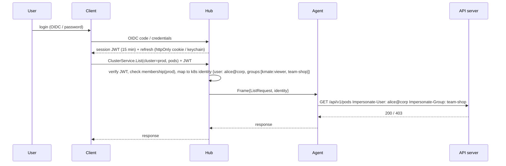

# 06 · Security Model

## Threat model summary

| Asset | Threat | Mitigation |
|-------|--------|------------|
| Cluster API access | Stolen client device | Clients hold only a short-lived Hub session token; no kubeconfig ever leaves the cluster. Tokens revocable at Hub. |
| Agent tunnel | MITM / rogue hub | Agent pins the Hub CA (from enrollment) and uses mTLS with its issued cert. |
| Agent | Rogue agent registering as another cluster | Enrollment token is single-use (or bounded), cluster identity bound to cert CN + kube-system namespace UID. |
| Hub | Compromised Hub | Hub has *no* cluster credentials. It can only ask an agent to do things, and the agent applies impersonation + RBAC. Blast radius = what agent SA can do. |
| Users | Privilege escalation | Hub roles + Kubernetes RBAC via impersonation. Write verbs off by default in Helm values. |
| Audit | Repudiation | Every mutating and exec/log request audit-logged at Hub with user, cluster, object, request id; forwarded to stdout/SIEM. |
| Secrets | Data exposure | Secret values masked in UI by default; reveal requires explicit action, audited, and can be disabled per cluster (`values.secrets.allowReveal=false`). |

## Identity flow



If impersonation isn't granted to the agent (Helm `rbac.impersonate=false`), the
agent uses its own identity and the Hub enforces only its own coarse roles. The UI
shows a "shared identity" badge on such clusters.

## Authorization model

Authorization is **layered**. The hub decides what you can reach; Kubernetes decides
what you can actually do. Both must agree, so the weaker of the two always wins.

### Layer 1 — KMate grants (what you can reach)

Every account carries a global role, and access to each cluster is an explicit grant:

```
cluster_grants(user_id, cluster_id, role, namespaces)
```

| Field | Meaning |
|---|---|
| `role` | `viewer`, `operator` or `admin` **on that cluster** |
| `namespaces` | JSON array; empty means every namespace |

Rules:

- A **global admin** is admin on every cluster and is never namespace-limited.
  Only admins manage users, grants and cluster registration.
- Everyone else reaches a cluster **only** through a grant. A cluster you hold no
  grant on does not appear in `ListClusters` at all: invisible rather than forbidden.
- A global role never elevates a grant. A global `operator` with a `viewer` grant on
  cluster X is a viewer on X.
- Writes (`Apply`, `Patch`, `Delete`, `Scale`, `RolloutRestart`, exec) need `operator`
  or better on that cluster.
- A namespace-limited grant may not make cluster-scoped or all-namespace requests,
  because both would reveal objects outside the grant. Ask for a specific namespace.

Enforcement matrix:

| Request | Needs | Namespace checked |
|---|---|---|
| `ListClusters`, `WatchClusters` | any grant (filtered per cluster) | no |
| `GetCluster`, `Discover`, `GetCatalog`, `AccessReview` | grant on the cluster | no (no object data) |
| `List`, `Get`, `Watch`, `Logs`, `GetMetrics`, Helm reads | grant | yes |
| `Apply`, `Patch`, `Delete`, `Scale`, `RolloutRestart` | grant with `operator`+ | yes |
| `/ws/.../exec` | grant with `operator`+ (exec can change anything) | yes |
| `/ws/.../portforward`, `/pf/...` | grant | yes |
| `CreateCluster`, `DeleteCluster`, user and grant administration | global `admin` | no |

Grants and roles are read from the database **on every request**, not from the JWT,
so revoking a grant or deactivating an account takes effect immediately instead of
when the token expires. A deactivated account is refused at the interceptor and
cannot log in.

Every denial is written to the audit log with the reason, so attempts are visible,
not just successes.

### Layer 2 — Kubernetes identity (what you can do)

Each account maps to a Kubernetes identity the agent impersonates:

| Column | Default |
|---|---|
| `k8s_user` | the account's email |
| `k8s_groups` | `["kmate:<global role>"]` |

The hub puts this identity on every relayed request and the agent sets
`Impersonate-User` / `Impersonate-Group`, so your own Roles and RoleBindings are the
final authority and every action appears in the cluster's audit log as that user.
A KMate `operator` grant does not bypass Kubernetes: without a matching RoleBinding
the API server still answers 403.

OIDC will populate `k8s_user` and `k8s_groups` from token claims in a later phase.
The shape is deliberately stable so that change needs no migration.

### Access review

`ClusterService.AccessReview` answers "may I do X" for a batch of resource/verb pairs,
so the UI can hide actions that would fail (the approach Headlamp takes). KMate grants
are checked first, then the agent issues a `SelfSubjectAccessReview` with the
impersonated client, which is exactly what `kubectl auth can-i` does. Answers are
cached for 30 seconds per identity and question.

Without impersonation the answers describe the agent's own ServiceAccount and carry
`reason: "shared identity"`, so the UI can say the permissions shown are approximate.

## Agent RBAC (Helm defaults)

- `rbac.read=true`: `get,list,watch` on `*.*` + non-resource `/metrics`, `/healthz`, `/version`.
- `rbac.write=false`: `create,update,patch,delete` on workloads/config/network/storage.
- `rbac.exec=false`: `pods/exec`, `pods/attach`, `pods/portforward`.
- `rbac.impersonate=false`: `impersonate` on `users`, `groups`, `serviceaccounts`.
- `rbac.secretsRead=true`: can be set false to exclude Secrets from the reader role entirely.

## Transport

- Client ⇄ Hub: TLS 1.2+, HSTS, CSP on the SPA.
- Agent ⇄ Hub: gRPC over TLS 1.3, mTLS, cert lifetime 30 days, auto-renewed at 2/3 lifetime over the existing tunnel.
- Enrollment token: `kmt_enr_<random 32B base64url>`, expires 24 h, single-use by default.

## Supply chain

- Distroless images, non-root, read-only rootfs, `seccompProfile: RuntimeDefault`.
- SBOM + cosign signatures on releases. Helm chart signed.
- Dependabot / Renovate.
