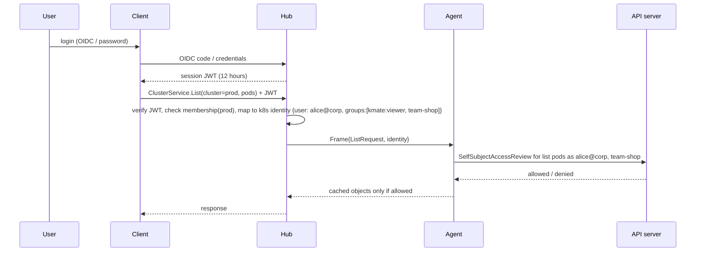

# 06 · Security Model

## Threat model summary

| Asset | Threat | Mitigation |
|-------|--------|------------|
| Cluster API access | Stolen client device | Clients hold only a short-lived Hub session token; no kubeconfig ever leaves the cluster. Tokens revocable at Hub. |
| Agent tunnel | MITM / rogue hub | Agent pins the Hub CA (from enrollment) and uses mTLS with its issued cert. |
| Agent | Rogue agent registering as another cluster | Enrollment token is single-use (or bounded), cluster identity bound to cert CN + kube-system namespace UID. |
| Hub | Compromised Hub | Hub has *no* cluster credentials. It can only ask an agent to do things, and the agent applies impersonation + RBAC. Blast radius = what agent SA can do. |
| Users | Privilege escalation | Hub roles + Kubernetes RBAC via impersonation. Write verbs off by default in Helm values. |
| Audit | Repudiation | Every mutating and exec/log request audit-logged at Hub with user, cluster, object, request id; forwarded to stdout/SIEM. |
| Secrets | Data exposure | The Data tab masks values by default; the YAML view and API expose the full object to callers with read access. |

## Identity flow



If impersonation isn't granted to the agent (Helm `rbac.impersonate=false`), the
agent uses its own identity and the Hub enforces only its own coarse roles. The UI
shows a "shared identity" badge on such clusters.

## Authorization model

Authorization is **layered**. The hub decides what you can reach; Kubernetes decides
what you can actually do. Both must agree, so the weaker of the two always wins.

### Layer 1 — KMate grants (what you can reach)

Every account carries a global role, and access to each cluster is an explicit grant:

```
cluster_grants(user_id, cluster_id, role, namespaces)
```

| Field | Meaning |
|---|---|
| `role` | `viewer`, `operator` or `admin` **on that cluster** |
| `namespaces` | JSON array; empty means every namespace |

Rules:

- A **global admin** is admin on every cluster and is never namespace-limited.
  Only admins manage users, grants and cluster registration.
- Everyone else reaches a cluster **only** through a grant. A cluster you hold no
  grant on does not appear in `ListClusters` at all: invisible rather than forbidden.
- A global role never elevates a grant. A global `operator` with a `viewer` grant on
  cluster X is a viewer on X.
- Writes (`Apply`, `Patch`, `Delete`, `Scale`, `RolloutRestart`, exec) need `operator`
  or better on that cluster.
- A namespace-limited grant may not make cluster-scoped or all-namespace requests,
  because both would reveal objects outside the grant. Ask for a specific namespace.

Enforcement matrix:

| Request | Needs | Namespace checked |
|---|---|---|
| `ListClusters`, `WatchClusters` | any grant (filtered per cluster) | no |
| `GetCluster`, `Discover`, `AccessReview` | grant on the cluster | no (cluster metadata or permission questions) |
| `GetCatalog`, `WatchCatalog` | grant on the cluster | catalog entries filtered to grant namespaces |
| `List`, `Get`, `Watch`, `Logs`, `GetMetrics`, Helm reads | grant | yes |
| `Apply`, `Patch`, `Delete`, `Scale`, `RolloutRestart` | grant with `operator`+ | yes |
| `/ws/.../exec` | grant with `operator`+ (exec can change anything) | yes |
| `/ws/.../portforward`, `/pf/...` | grant | yes |
| `CreateCluster`, `DeleteCluster`, user and grant administration | global `admin` | no |

Grants and roles are resolved from the database with a two-second cache rather than
trusted from the JWT. User/grant administration invalidates that cache and closes
the user's open Connect, WebSocket, and HTTP port-forward streams immediately.
OIDC and external directory changes are detected within two seconds. Streams also
end when their token expires. A deactivated account cannot log in.

Every denial is written to the audit log with the reason, so attempts are visible,
not just successes.

### Layer 2 — Kubernetes identity (what you can do)

Each account maps to a Kubernetes identity the agent impersonates:

| Column | Default |
|---|---|
| `k8s_user` | the account's email |
| `k8s_groups` | the groups from the identity provider, if any |

`kmate:<global role>` is **always** impersonated in addition to whatever is in
`k8s_groups`, so a cluster can bind `kmate:admin` once and have it apply to every
admin, whatever the identity provider happens to call its own groups.

The hub puts this identity on every relayed request and the agent sets
`Impersonate-User` / `Impersonate-Group`, so your own Roles and RoleBindings are the
final authority. List, watch, and cached get operations first perform a fresh
SelfSubjectAccessReview as the caller; the shared informer still runs as the agent.
Live operations and access reviews appear in Kubernetes audit logs as the user.
A KMate `operator` grant does not bypass Kubernetes: without a matching RoleBinding
the API server still answers 403.

OIDC populates `k8s_user` and `k8s_groups` from token claims; see
[12-oidc.md](12-oidc.md).

### Access review

`ClusterService.AccessReview` answers "may I do X" for a batch of resource/verb pairs,
so the UI can hide actions that would fail (the approach Headlamp takes). KMate grants
are checked first, then the agent issues a `SelfSubjectAccessReview` with the
impersonated client, which is exactly what `kubectl auth can-i` does. Answers are
cached for 30 seconds per identity and question.

Without impersonation the answers describe the agent's own ServiceAccount and carry
`reason: "shared identity"`, so the UI can say the permissions shown are approximate.

## Agent RBAC (Helm defaults)

- `rbac.read=true`: `get,list,watch` on `*.*` + non-resource `/metrics`, `/healthz`, `/version`.
- `rbac.write=false`: `create,update,patch,delete` on workloads/config/network/storage.
- `rbac.exec=false`: `pods/exec`, `pods/attach`, `pods/portforward`.
- `rbac.impersonate=true`: `impersonate` on `users`, `groups`, `serviceaccounts` and
  `userextras/*`. On by default, because without it every KMate user shares the
  agent's own permissions. Turn it off only where the agent may not be granted the
  impersonate verb.
- `rbac.secretsRead=true`: can be set false to exclude Secrets from the reader role entirely.

## Binding KMate users to Kubernetes RBAC

With impersonation on, the agent performs each call **as the signed-in user**, so
your own Roles and RoleBindings decide what actually happens and the cluster audit
log names the real person. KMate grants decide what someone can *reach*; Kubernetes
decides what they can *do*. Neither can widen the other.

Each KMate user carries a Kubernetes identity: `k8s_user` (defaults to their email)
and `k8s_groups`. Binding a **group** rather than each individual is usually easier,
because adding someone to the group in KMate, or in your identity provider, grants
access without touching the cluster again.

A worked example. Give the platform team read access to one namespace:

```bash
# 1. In KMate: the user's Kubernetes identity carries the group.
#    (Settings → Users, or CreateUser with k8sGroups: ["kmate-devs"].)

# 2. In KMate: let them reach that cluster, limited to one namespace.
#    (Settings → Users → Grants, role "operator", namespaces ["shop"].)

# 3. In Kubernetes: decide what the group may actually do there.
kubectl -n shop create rolebinding kmate-devs-view \
  --clusterrole=view --group=kmate-devs
```

The result is deliberately conservative. That user is an *operator* in KMate, so the
interface offers write actions, but the API server refuses them because the binding
only grants `view`:

```
Forbidden: deployments.apps "shop-api" is forbidden: User "dev@kmate.local"
cannot patch resource "deployments/scale" in API group "apps" in the namespace "shop"
```

To let them write, swap `--clusterrole=view` for `edit`. Nothing in KMate changes.

The interface reflects this without being told: `ClusterService.AccessReview` asks the
API server what the user may do, so buttons they cannot use are disabled with the
cluster's own reason, for example *"RBAC: allowed by RoleBinding
\"kmate-devs-view/shop\" of ClusterRole \"view\" to Group \"kmate-devs\""*.

**Without impersonation** (`rbac.impersonate=false`) every request runs as the agent's
ServiceAccount. Everyone who can reach a cluster shares its permissions, the cluster
audit log shows only the agent, and access reviews come back marked *shared identity*
so the interface can say so rather than implying the permission is personal. The
cluster list shows a **shared identity** badge in that state.

## Agent mutual TLS

The hub runs its own certificate authority, generated on first start and persisted,
so certificates already issued keep validating across restarts. The root lives for ten
years; agent certificates live for 30 days and renew automatically.

At enrolment the agent generates a keypair locally and sends only a certificate
signing request, so the private half of its identity never reaches the hub. The hub
names the certificate from the enrolment it just validated and ignores whatever the
request asks for, which means an agent cannot obtain a certificate for another
cluster. Both ids appear as SANs:

```
Subject: O=KMate, OU=agent, CN=<cluster id>
X509v3 Subject Alternative Name:
    URI:kmate://cluster/<cluster id>, URI:kmate://agent/<agent id>
X509v3 Extended Key Usage: TLS Web Client Authentication
```

On the agent listener a presented certificate is verified against that root and is the
stronger claim: the connection is attributed to the cluster named in the certificate,
and a `Hello` that disagrees is rejected.

`KMATE_AGENT_MTLS` controls enforcement:

| Mode | A certificate | No certificate |
|------|---------------|----------------|
| `off` | ignored, none issued | bearer token accepted |
| `optional` (default) | verified and used | bearer token accepted |
| `required` | verified and used | **refused**: *"this hub requires agent mTLS; re-enroll to obtain a certificate"* |

**Rotating a fleet.** Leave the default while you upgrade. An agent that enrolled
before mTLS existed connects on its bearer token, then asks for its first certificate
over that same tunnel within seconds, because the connection is already attributed to
a cluster. No new enrolment tokens, no redeploy. Renewal afterwards happens at two
thirds of the certificate's life by the same route. Watch
`kmate_agent_cert_expiry_seconds`, and once every agent reports one, set
`KMATE_AGENT_MTLS=required` so a stolen bearer token is no longer enough.

A renewed certificate takes effect on the agent's next reconnect, so rotation never
interrupts a client session.

## Single sign-on

KMate accepts any standards-compliant OIDC provider. The hub reads the issuer's
discovery document, so Keycloak, Okta, Authentik, Entra, Google and Dex are the
same code path.

The flow is the authorization-code grant with PKCE. Login state lives in a
signed, HttpOnly, SameSite=Lax cookie that expires in ten minutes and carries the
nonce, the PKCE verifier and the post-login path; an absolute or off-origin
redirect is collapsed to `/`. The ID token is verified against the provider's
JWKS and its nonce matched before any account is touched. The session token comes
back in the URL fragment rather than the query string, so it does not land in
proxy or access logs.

**Claims become the Kubernetes identity.** The username claim is written to
`k8s_user` and the groups claim to `k8s_groups`, which is what the agent
impersonates. The effect is that the directory you already run decides what
people can do in the cluster, enforced by the API server rather than by KMate:

```
provider group "platform-admins", KMate role admin
   → user.k8s_groups = ["platform-admins"]
   → agent impersonates Impersonate-Group: platform-admins
                        Impersonate-Group: kmate:admin
   → your ClusterRoleBinding decides
```

Bind whichever suits you. Binding the provider's group keeps authorization in the
directory you already run; binding `kmate:<role>` keeps it tied to KMate's own
roles and survives a rename in the directory.

Group-to-role mappings (`KMATE_OIDC_ADMIN_GROUPS` and friends) additionally set
the KMate role, re-evaluated on every login so directory changes take effect at
the next sign-in. Without mappings everyone gets the default role and you assign
cluster access by grant instead.

Accounts provisioned by a provider carry a flag, have no password hash, and are
refused by the password form with a message pointing at the SSO button, so an
administrator cannot accidentally create a local bypass for a federated identity.
Auto-provisioning can be disabled, in which case an administrator must create the
account first and login matches on the username claim.

`KMATE_LOCAL_LOGIN=false` disables passwords entirely, but is ignored when no
issuer is configured so a misconfiguration cannot lock everyone out. Keep one
local administrator until SSO is proven.

## Enrolment tokens

- A token is **single use**. The first agent to enrol with it consumes it; every later
  attempt is refused with `enrollment token has already been used`. The claim is one
  atomic statement, so two agents racing cannot both win.
- Tokens expire after **24 hours** whether used or not.
- **One live token per cluster.** Issuing a replacement invalidates any outstanding
  unused token, so rotating a leaked token actually revokes it.
- An agent that still holds its identity (Secret `kmate-agent-identity`, or the file
  named by `--identity-file`) **never needs a token again**. Tokens are only for first
  contact.
- Lost that identity? An admin issues a replacement from the cluster's actions menu, or
  via `HubService.IssueEnrollmentToken`. The action is audited as `cluster.token.issue`.
- When an agent displaces another live agent for the same cluster the hub logs a warning
  and writes an audit row. A rolling restart looks identical to a takeover, so the audit
  log is how you tell them apart.

## Apply payload validation

The hub checks that an Apply envelope's API version, kind, name, and namespace
match its JSON payload, then authorizes the payload's actual namespace.

## Transport

- Client ⇄ Hub: TLS 1.2+; production ingress headers are configured by the operator.
- Agent ⇄ Hub: gRPC over TLS 1.2+, mTLS, cert lifetime 30 days, auto-renewed at 2/3 lifetime over the existing tunnel.
- Enrollment token: `kmt_enr_<random 32B base64url>`, expires 24 h, single-use by default.

## Supply chain

- Distroless images, non-root, read-only rootfs, `seccompProfile: RuntimeDefault`.
- SBOMs, release/chart signatures, and automated dependency updates are planned.
